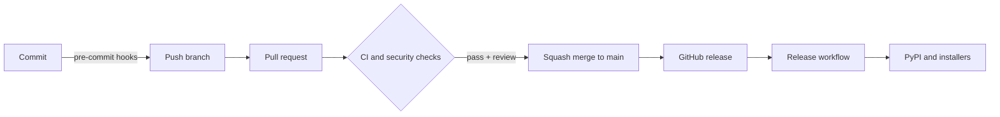
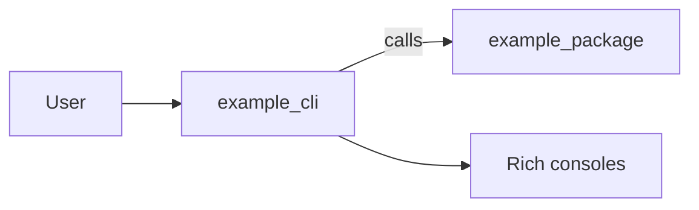
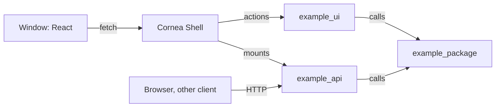

# Architecture

How the pieces of this template fit together. For day-to-day commands, see [development](development.md). For one-time repository settings, see [repository setup](repo-setup.md).

## Overview

A change moves through three layers of checks before it reaches `main`, and a release moves through one more before it reaches PyPI or the installers.



## Layers

| Layer | What runs | Where |
| --- | --- | --- |
| Local | gitleaks, file hygiene, markdownlint, Ruff, `uv lock` check, mypy, Sweepito scan and cleanup | pre-commit hooks |
| Pull request | `ci` (per package: lint, UI checks, unit and integration tests on Python 3.11 to 3.15 on Ubuntu plus 3.11 on Windows and macOS, Windows UI test, build; the installers), dependency review, Semgrep, CodeQL | GitHub Actions |
| Repository | Branch ruleset, secret scanning with push protection, Dependabot alerts and updates | GitHub settings |
| Release | Tag and version check, build, trusted publish to PyPI per package, installers on the release | `release.yml` |

## Source layout

```text
packages/core/src/example_package/   typed library: all the logic, never prints or exits
packages/cli/src/example_cli/        Typer + Rich command line over the library
packages/api/src/example_api/        FastAPI app over the library: routers, schemas, errors, settings
packages/ui/src/example_ui/          Cornea Shell wiring and the `example-ui` command
packages/ui/src/example_ui/ui/       React + Vite frontend (JavaScript); `dist/` is built, not committed
packages/docker/                     Dockerfile, image tests and docs of the container image (built from core and cli)
packages/*/tests/                    unit/ (coverage, 80% minimum) and integration/ (marked `integration`: skipped by default and in pre-commit, run in CI)
packages/*/docs/                     each package's architecture, development, packaging, security and guides
installer/                           PyInstaller spec, NSIS script, nfpm config, build script and pinned tool versions
brand/                               sample icon and setup artwork
scripts/                             repository settings and the Init rename script
pyproject.toml                       uv workspace root: dev dependencies and shared tool configuration
uv.lock                              locked dependency set, checked by CI with --locked
```

The repository is a uv workspace of four Python packages, plus a Docker image, that are tested and versioned separately. The core and the command line are published to PyPI; the API and the window ship in the installers. Each version lives in one place (`__version__` in the core and the command line, `version` in the API's and the window's `pyproject.toml`), and the release workflow compares it with the release tag. Each package has its own architecture notes: [core](../packages/core/docs/architecture.md), [command line](../packages/cli/docs/architecture.md), [API](../packages/api/docs/architecture.md) and [window](../packages/ui/docs/architecture.md).

## Library and CLI layers



- `example_cli` parses arguments with Typer, calls `example_package`, and writes all output through the shared Rich consoles: data to stdout, messages and errors to stderr.
- `example_package` holds the logic. It raises exceptions instead of printing or exiting, so other front ends can reuse it.
- The console script `example-cli` and `python -m example_cli` both enter through `example_cli.cli`. The packages ship as separate wheels.

## UI and API layers



- `example_api` validates input, calls `example_package` and shapes responses. It runs on its own on any system, or is mounted inside Cornea.
- `example_ui` only wires Cornea to the API and the library, and holds the `example-ui` entry point. It is the one place there that shows output and sets exit codes.
- `example_package` and `example_api` never import `example_ui`, and `example_package` never imports `example_api`. The Windows-only dependency (`cornea-shell`) is imported lazily.

## Workflows

| Workflow | Trigger | Purpose |
| --- | --- | --- |
| `ci.yml` | Pull request, push to `main` | Calls `ci-core.yml`, `ci-cli.yml`, `ci-api.yml`, `ci-ui.yml` (lint, tests, integration tests, build), `ci-docker.yml` (builds the image and tests it), `ci-repo.yml` (everything outside `packages/`) and `ci-installer.yml` (builds, installs and removes the installers, after the cli and ui passed). `changes.yml` limits a pull request to the parts it touches. A final `ci` job gates on all of them and is the only check the ruleset requires. |
| `security.yml` | Pull request, push to `main`, weekly, manual | Calls `security-core.yml`, `security-cli.yml`, `security-api.yml`, `security-ui.yml`, `security-docker.yml` (Semgrep, Trivy on the Dockerfile and, weekly, on the image) and `security-repo.yml`: Semgrep, uploaded as code scanning results. Not required. |
| `api-compat.yml` | Pull request that changes `packages/api/docs/openapi.json` | Reports breaking API changes with oasdiff. Not required. |
| `dependency-review.yml` | Pull request | Blocks pull requests that add vulnerable dependencies. |
| `audit.yml` | Weekly, manual, and pull requests that change a lock file | Calls `audit-<package>.yml` and `audit-repo.yml`: `pip-audit` on each package's locked dependencies, and `npm audit` for the frontend. |
| `release.yml` | GitHub release published | Routes by tag: `vX.Y.Z` releases the core, `cli-vX.Y.Z` the command line (PyPI), `installer-vX.Y.Z` the installers (attached to the release), `docker-vX.Y.Z` the image (GHCR). Each waits for its environment's approval. See [releasing](releasing.md). |
| `init.yml` | Manual | One-time: replaces the owner and repository name, renames the example packages and commands to your name, regenerates the lock file and the OpenAPI document, and opens a pull request. Skipped in the template itself. |

CodeQL runs through GitHub's default setup rather than a workflow file.

## Branch governance

The `main` ruleset in `.github/rulesets/main.json` is applied by `scripts/apply_repo_settings.py`. It requires:

- a pull request with a code owner review and resolved conversations, squash merge only
- the `ci` and `dependency-review` checks, with the branch up to date
- CodeQL results
- no deletion and no force push

Repository admins can bypass through a pull request so a solo maintainer is not locked out.

## Release flow

1. Bump the package's version and update its `CHANGELOG.md` in a pull request.
2. After merge, publish a GitHub release tagged for the part you release (`v<version>`, `cli-v<version>` or `installer-v<version>`). Release the core first, because the command line depends on it.
3. `release.yml` builds in one job, then a second job in the part's environment publishes (PyPI through OpenID Connect, or the files on the release). No API token is stored, and only the publish jobs get the `id-token` permission. The full routing is in [releasing](releasing.md).

## Template lifecycle

GitHub copies files, not settings. A new repo therefore needs these steps: run **Init** with a name and title, which replaces the owner and repository name and renames the example packages and commands ([development](development.md)); replace the icon; run the settings script to apply protections and the ruleset; and optionally switch on signing and the package-manager channels ([releasing](releasing.md)).
