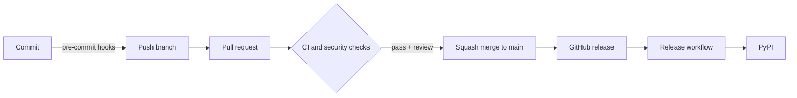
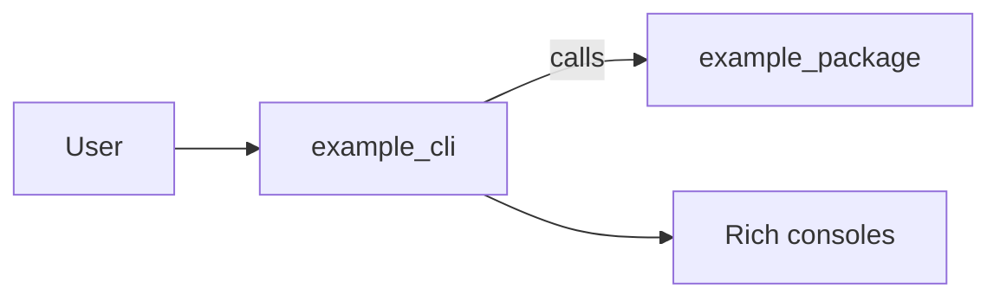
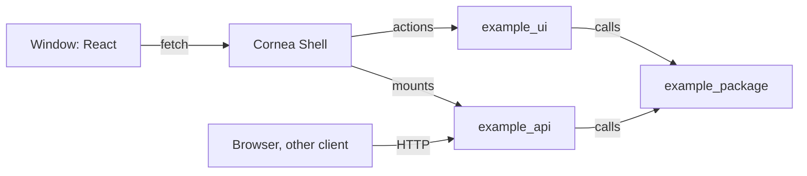

# Architecture

How the pieces of this template fit together. For day-to-day commands, see [development](development.md). For one-time repository settings, see [repository setup](repo-setup.md).

## Overview

A change moves through three layers of checks before it reaches `main`, and a release moves through one more before it reaches PyPI.



## Layers

| Layer | What runs | Where |
| --- | --- | --- |
| Local | gitleaks, file hygiene, markdownlint, Ruff, `uv lock` check, mypy, Sweepito scan and cleanup | pre-commit hooks |
| Pull request | `ci` (lint, UI checks, unit and integration tests on Python 3.11 to 3.15 on Ubuntu plus 3.11 on Windows and macOS, Windows UI test, build), dependency review, CodeQL | GitHub Actions |
| Repository | Branch ruleset, secret scanning with push protection, Dependabot alerts and updates | GitHub settings |
| Release | Version check, wheel and sdist (core library and command line), trusted publish to PyPI, installers and package-manager updates | `release.yml` |

## Source layout

```text
src/example_package/   typed library: all the logic, never prints or exits
src/example_cli/       Typer + Rich command line over the library
src/example_api/       FastAPI app over the library: routers, schemas, errors, settings
src/example_ui/        Cornea Shell wiring and the `example-ui` command
src/example_ui/ui/     React + Vite frontend (JavaScript); `dist/` is built, not committed
installer/               PyInstaller specs, NSIS scripts, nfpm config and pinned tool versions
scripts/                 repository settings, OpenAPI export, installer build and manifest generation
tests/<component>/     pytest unit tests with coverage (80% minimum), one folder each for core, cli, api and ui
tests/<component>/integration/   tests marked `integration`: skipped by default and in pre-commit, run in CI
pyproject.toml         metadata, dev dependencies and tool configuration
uv.lock                locked dependency set, checked by CI with --locked
```

The version lives in one place, `__version__` in the package, and Hatchling reads it at build time. The release workflow compares it with the release tag.

## Library and CLI layers



- `example_cli` parses arguments with Typer, calls `example_package`, and writes all output through the shared Rich consoles: data to stdout, messages and errors to stderr.
- `example_package` holds the logic. It raises exceptions instead of printing or exiting, so other front ends can reuse it.
- The console script `example-cli` and `python -m example_cli` both enter through `example_cli.cli:app`. Both packages ship in one wheel and share the version in `example_package.__version__`.

## UI and API layers



- `example_api` validates input, calls `example_package` and shapes responses. It runs on its own on any system, or is mounted inside Cornea.
- `example_ui` only wires Cornea to the API and the library, and holds the `example-ui` entry point. It is the one place there that shows output and sets exit codes.
- `example_package` and `example_api` never import `example_ui`, and `example_package` never imports `example_api`. The Windows-only dependency (`cornea-shell`) is imported lazily.

## Workflows

| Workflow | Trigger | Purpose |
| --- | --- | --- |
| `ci.yml` | Pull request, push to `main` | Runs `lint`, `ui`, `test`, `integration`, `ui-windows` and `build`. A final `ci` job gates on all of them and is the only check the ruleset requires. |
| `api-compat.yml` | Pull request that changes `docs/openapi.json` | Reports breaking API changes with oasdiff. Not required. |
| `security.yml` | Pull request, push, weekly | Semgrep, uploaded as code scanning results. Not required. |
| `dependency-review.yml` | Pull request | Blocks pull requests that add vulnerable dependencies. |
| `audit.yml` | Weekly, manual, and pull requests that change a lock file | Runs `pip-audit` and `npm audit` on the locked dependencies to catch newly published vulnerabilities. |
| `build.yml` | Pull request that touches the installers | Builds the Windows setups and Linux packages, installs each, runs it and uninstalls it. Not required. |
| `release.yml` | GitHub release published | Checks the tag matches the version, builds the wheel (core library and command line), publishes to PyPI, builds and optionally signs the installers, attaches them with checksums to the release, and opens Homebrew, Scoop and winget pull requests when switched on. |
| `init.yml` | Manual | One-time: replaces the owner and repository name, renames the example packages and commands to your name, regenerates the lock file and generated docs, and opens a pull request. Skipped in the template itself. |

CodeQL runs through GitHub's default setup rather than a workflow file.

## Branch governance

The `main` ruleset in `.github/rulesets/main.json` is applied by `scripts/apply_repo_settings.py`. It requires:

- a pull request with a code owner review and resolved conversations, squash merge only
- the `ci` and `dependency-review` checks, with the branch up to date
- CodeQL results
- no deletion and no force push

Repository admins can bypass through a pull request so a solo maintainer is not locked out.

## Release flow

1. Bump `__version__` and update `CHANGELOG.md` in a pull request.
2. After merge, publish a GitHub release tagged `v<version>`.
3. `release.yml` builds the sdist and wheel (the core library and the command line only; the API and the window ship in the installers) in one job, then a second job in the `pypi` environment publishes them using OpenID Connect. No API token is stored, and only the publish job gets the `id-token` permission.

## Template lifecycle

GitHub copies files, not settings. A new repo therefore needs these steps: run **Init** with a name and title, which replaces the owner and repository name and renames the example packages and commands ([development](development.md)); replace the icon; run the settings script to apply protections and the ruleset; and optionally switch on signing and the package-manager channels ([releasing](releasing.md)).
