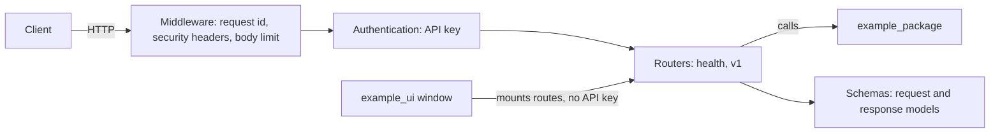

# Architecture

How `example-api`, the HTTP API, is built. It is a FastAPI app over [`example-package`](../../core/docs/architecture.md): routes validate input, call the library and shape the response. It runs on its own on any system, and the same routes are mounted inside the Windows window ([window guide](../../ui/docs/guides/ui.md)). It is not published to PyPI.

## Overview

The package is `packages/api/src/example_api/`:

| Module | Purpose |
| --- | --- |
| `main.py` | `create_app()`: builds the FastAPI app, wires middleware, error handlers and routers. |
| `__main__.py` | `serve()`: starts uvicorn with the settings (`python -m example_api`). |
| `config.py` | `Settings` read from `EXAMPLE_API_*` variables or `.env`, and `get_settings()`. |
| `auth.py` | API-key authentication, and the principal the window uses when it mounts the routes. |
| `security.py` | Security headers and the request body limit. |
| `errors.py` | Problem-details (`application/problem+json`) error responses and handlers. |
| `logs.py` | Logging setup and the request ID middleware. |
| `schemas.py` | The request and response models: the shape of the contract. |
| `routers/health.py` | `GET /health` and `GET /ready`, with no authentication. |
| `routers/v1.py` | The `/api/v1` endpoints (hello, whoami, greetings) over the library. |

## Rules

- **Thin routes.** A route validates, calls the library, and shapes the result. Logic belongs in `example_package`, which never imports the API.
- **The contract is versioned.** `/api/v1` is the public contract. A breaking change goes in a new `/api/v2` router. `packages/api/docs/openapi.json` is generated from the code, CI fails when it is out of date, and `api-compat.yml` reports breaking changes on pull requests.
- **Errors are problem details.** Every error, including `500`, is `application/problem+json` with the request ID, and a `500` never shows internals.
- **Secure by default.** The app will not start without an API key unless authentication is switched off with `EXAMPLE_API_AUTH_MODE=none`. See [security](security.md).
- **One state, injected.** The greeting store is created once (`get_store`) and injected into routes, so tests can reset it.

## Adding an endpoint

1. Add the logic to `example_package`, with tests there.
2. Add the request and response models to `schemas.py`.
3. Add the route to a router, with `authenticate` as a dependency if it is protected, and a response model so the contract is complete.
4. Run `uv run python packages/api/scripts/export_openapi.py` and commit `openapi.json`, then document the endpoint in the [API guide](api.md).
5. Add unit tests with FastAPI's `TestClient` under `tests/unit/`, and extend the contract test if needed.
