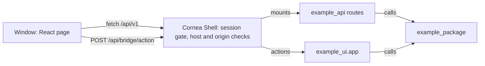

# Architecture

How `example-ui`, the native window, is built. It is a thin layer: [Cornea Shell](https://github.com/coldsofttech/CorneaShell) hosts a web frontend in a window, and the window mounts the [HTTP API](../../api/docs/architecture.md) and [`example-package`](../../core/docs/architecture.md) behind it. It runs on Windows only and is not published to PyPI: the Windows setup carries it.

## Overview

The package is `packages/ui/src/example_ui/`:

| Path | Purpose |
| --- | --- |
| `__main__.py` | The `example-ui` command: options (`--dev`, `--no-window`), output and exit code. |
| `app.py` | `build_shell()` and `run_ui()`: serves `ui/dist`, mounts the API routes, registers native actions (`app_info`). The app id, title and version are constants at its top. |
| `ui/` | The frontend: React and Vite (JavaScript), with its own `package.json`, tests and lint. `ui/dist/` is built, not committed. |

## Rules

- **Wiring only.** `app.py` connects Cornea to the API and the library. Business logic belongs in `example_package` and routes in `example_api`, neither of which may import `example_ui`.
- **Cornea is imported lazily.** `cornea-shell` is a Windows-only dependency (`sys_platform == 'win32'`), so everything that needs it is imported inside functions. Off Windows, `run_ui()` raises `UiUnavailableError` with a clear message and the command exits with code 1.
- **No second authentication.** Cornea's session gate authenticates every mounted route, so the API routes are mounted with API-key checks switched off. They must never be exposed any other way ([security](security.md)).
- **The frontend only talks to Python through `src/api.js`**, with `fetch` for data and the bridge for native actions.
- **Static files, dynamic app.** The built frontend is static; everything dynamic lives behind the API and the bridge.

## Adding a feature

1. Add the logic to `example_package` and a route to `example_api` (see their guides).
2. Call it from the frontend through `src/api.js`, and add a Vitest test for the component.
3. For something only the desktop can do (a file picker, opening a link), register a native action in `app.py` and call it through the bridge.
4. Rebuild the frontend (`npm run build`) and check it in the window with `uv run python -m example_ui`.
